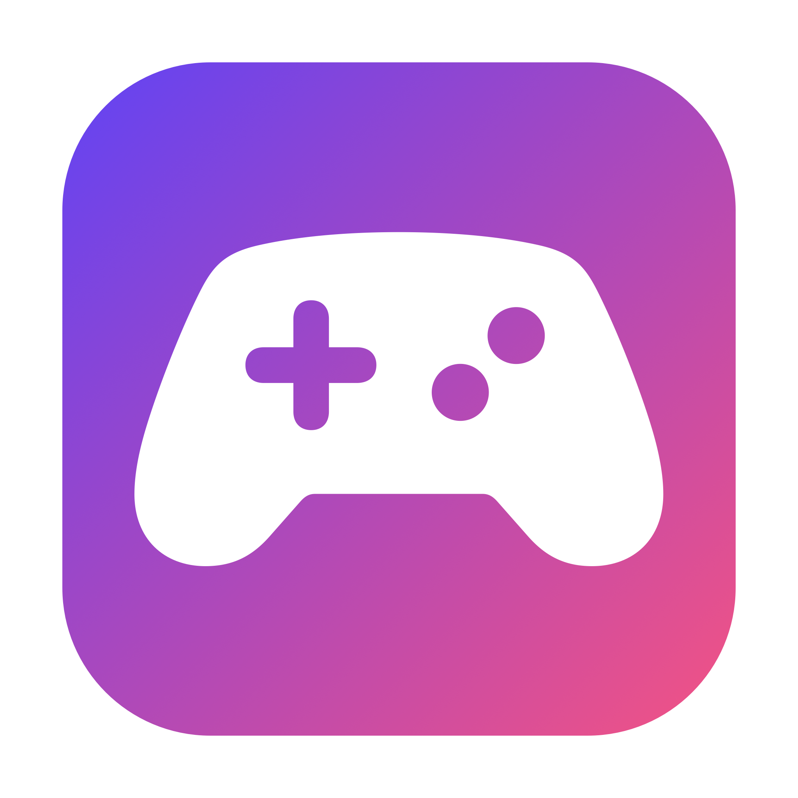
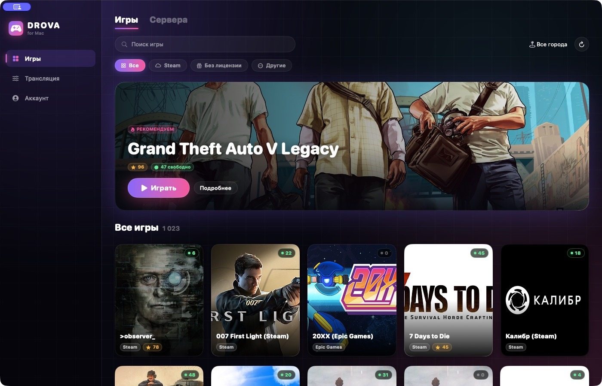
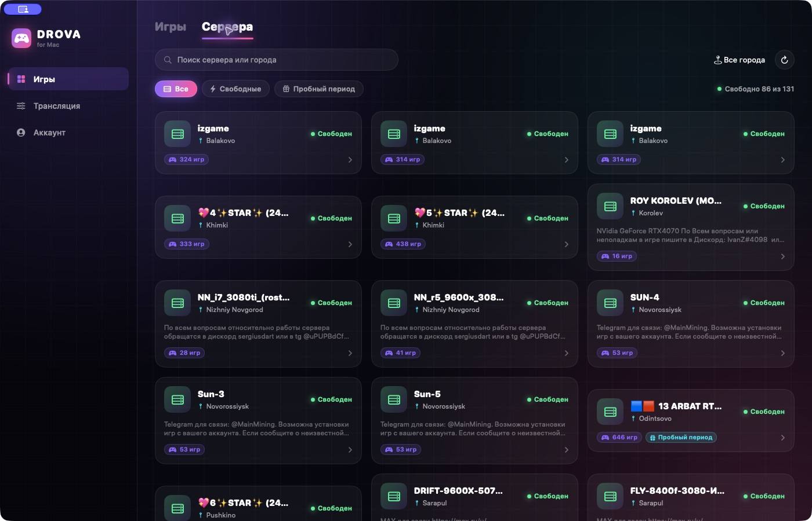
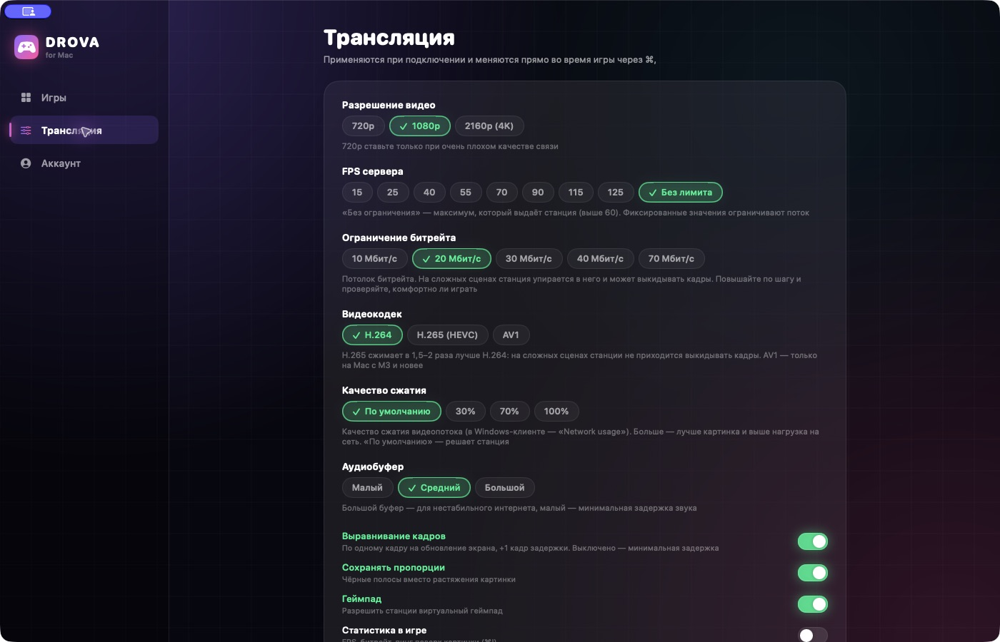

# Drova for Mac

**Облачные игры. Нативное приложение. Ваш Mac.**

### [Скачать DMG](https://github.com/HooMDooM/DrovaMac/releases/latest/download/Drova-macOS-universal.dmg) · [Скачать ZIP](https://github.com/HooMDooM/DrovaMac/releases/latest/download/Drova-macOS-universal.zip)

[Установка](INSTALL.md) · [Все версии](https://github.com/HooMDooM/DrovaMac/releases) · [Сообщить о проблеме](https://github.com/HooMDooM/DrovaMac/issues/new/choose) · [English](README.en.md)

Неофициальный клиент сервиса [Drova](https://drova.io) для macOS. Выбирайте игру и станцию, управляйте качеством трансляции и играйте в отдельном окне или на весь экран. CrossOver, Wine и Windows для запуска клиента не нужны.

В этом репозитории публикуются **готовые приложения, скриншоты и документация**. Исходный код не распространяется.

## Установка

1. [Скачайте DMG](https://github.com/HooMDooM/DrovaMac/releases/latest/download/Drova-macOS-universal.dmg).
2. Откройте образ и перенесите **Drova.app** в **Applications / Программы**.
3. Запустите Drova и войдите в свой аккаунт сервиса.
4. Выберите игру, город и свободную станцию.

**Первый запуск:** выпуск 1.0.0 имеет ad-hoc подпись, без Developer ID и нотариального заверения Apple. После первой попытки запуска macOS может потребовать подтверждение в **Системные настройки → Конфиденциальность и безопасность → Всё равно открыть**. [Подробная инструкция](INSTALL.md).

На странице Releases скачивайте **Drova DMG или ZIP**. Автоматические архивы GitHub **Source code** содержат только документацию.

## Возможности

| | |
|---|---|
| **Каталог** | Поиск, фильтры магазинов, описания игр и доступные станции |
| **Серверы** | Города, свободные станции и фильтр пробного периода |
| **Видео** | 720p, 1080p, 4K; H.264, HEVC и AV1 при аппаратной поддержке |
| **Качество** | FPS сервера, битрейт 10–70 Мбит/с, сжатие и выравнивание кадров |
| **Управление** | Клавиатура, мышь, совместимые с macOS геймпады, полный экран |
| **Звук** | Настройка аудиобуфера и отключение звука |
| **Сессии** | Повторное подключение и отдельное завершение игры |
| **Статистика** | FPS, пинг и битрейт поверх трансляции |

Фактическое качество зависит от Mac, станции и соединения. Полное соответствие Windows-клиенту не заявлено: UDP green/yellow, передача микрофона и внешние трансляции не входят в список поддерживаемых функций этого выпуска.

## Скриншоты

### Станции и города

### Настройки трансляции

На скриншотах скрыт блок личных данных аккаунта. Каталог и наличие станций меняются со временем.

## Требования

- **macOS 14 Sonoma или новее**.
- **Apple Silicon или Intel** — один Universal-файл.
- Аккаунт Drova, доступное игровое время и интернет.
- Для AV1 нужна аппаратная поддержка; недоступные кодеки отключены в интерфейсе.

Запуск проверен на Apple Silicon. Intel-архитектура скомпилирована и включена в приложение; отдельного теста на физическом Intel Mac не было. Полный игровой сеанс при подготовке этого выпуска не проводился. Интерфейс приложения — на русском.

## Горячие клавиши

| Клавиши | Действие |
|---|---|
| **Esc, Esc** | Освободить мышь; клик по игре захватывает её снова |
| **⌘ ,** | Настройки трансляции |
| **⌘ F** | Полный экран |
| **⌘ I** | Статистика |
| **⌘ M** | Звук |
| **⌘ K** | Экранная клавиатура станции |
| **⌘ W** | Диалог завершения или отключения |

**«Отключиться» оставляет удалённую сессию активной.** Чтобы закончить игру на станции, выберите **«Завершить»**. Учёт и стоимость времени определяет Drova.

## Обновления и помощь

Завершите игру, закройте приложение и замените Drova.app новой версией из Releases. Автообновления пока нет. Контрольные суммы SHA-256 находятся рядом с файлами выпуска.

[Инструкция и решение проблем](INSTALL.md) · [Изменения](CHANGELOG.md) · [Локальные данные](PRIVACY.md)

[Сообщить об ошибке](https://github.com/HooMDooM/DrovaMac/issues/new/choose): укажите macOS, модель Mac, версию приложения и шаги повторения. Скройте личные данные на скриншотах; не публикуйте пароли и токены.

---

Независимый неофициальный проект. Drova, названия игр и изображения каталога принадлежат соответствующим правообладателям. Клиент не предоставляет игровое время или лицензии на игры.
